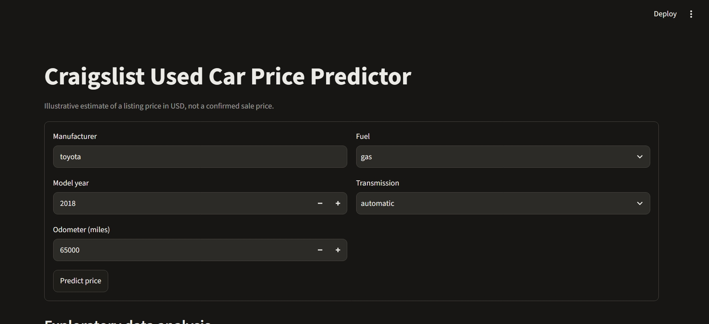
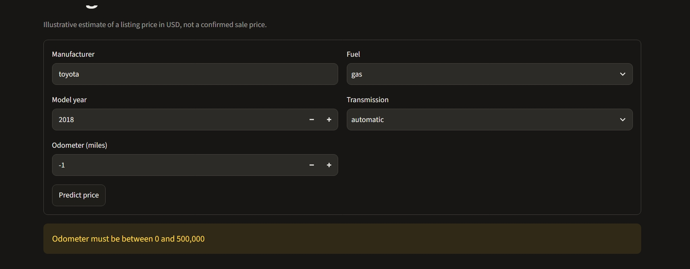
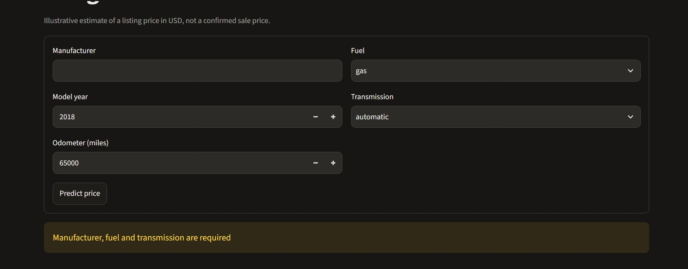
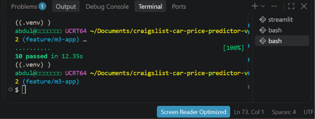

# M3 – Streamlit Interface

## Week 1: User Interaction and Stub UI

### 1. Target User

The target users are people who want to evaluate or compare used-car listings and need an estimated listing price based on basic vehicle specifications.

### 2. User Story

As a person evaluating a used-car listing, I want to enter the vehicle specifications so that I can receive an estimated listing price in USD and use it to help compare used cars.

### 3. Input Fields

The application accepts five inputs:

- Model year (year)
- Odometer (miles)
- Manufacturer
- Fuel type
- Transmission type

### 4. Expected Output

The application displays an estimated used-car listing price in USD.

The estimate is illustrative and does not represent a confirmed sale price.
### 5. Invalid Input Examples Planned

- Empty manufacturer: Display a required-fields warning.
- Negative odometer: Reject the input and display a validation warning.
- Model year outside configured limits: Prevent invalid year selection.

## 6. Screenshot Evidence

### 6.1 Normal Streamlit Interface

### 6.2 Invalid Odometer Input

### 6.3 Empty Manufacturer Input

### 6.4 Full Test Suite Results

